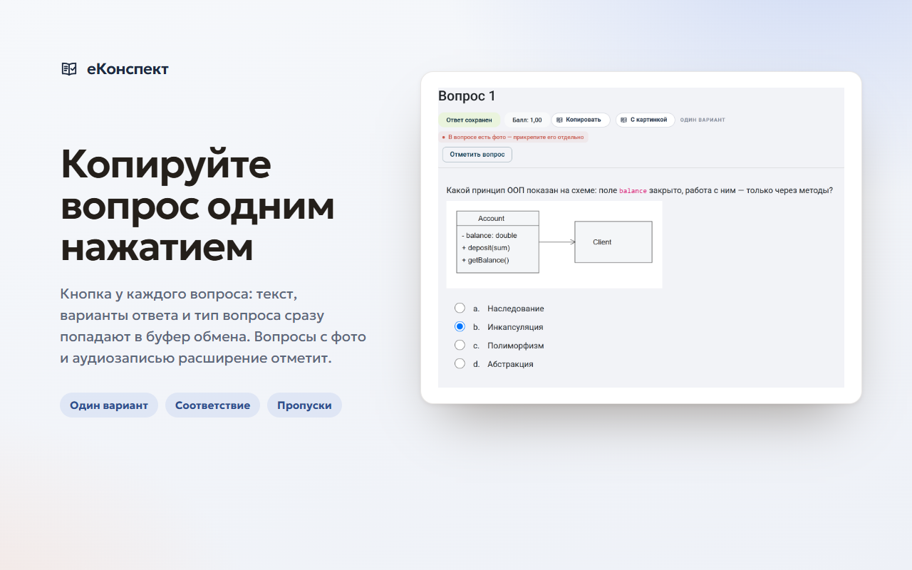
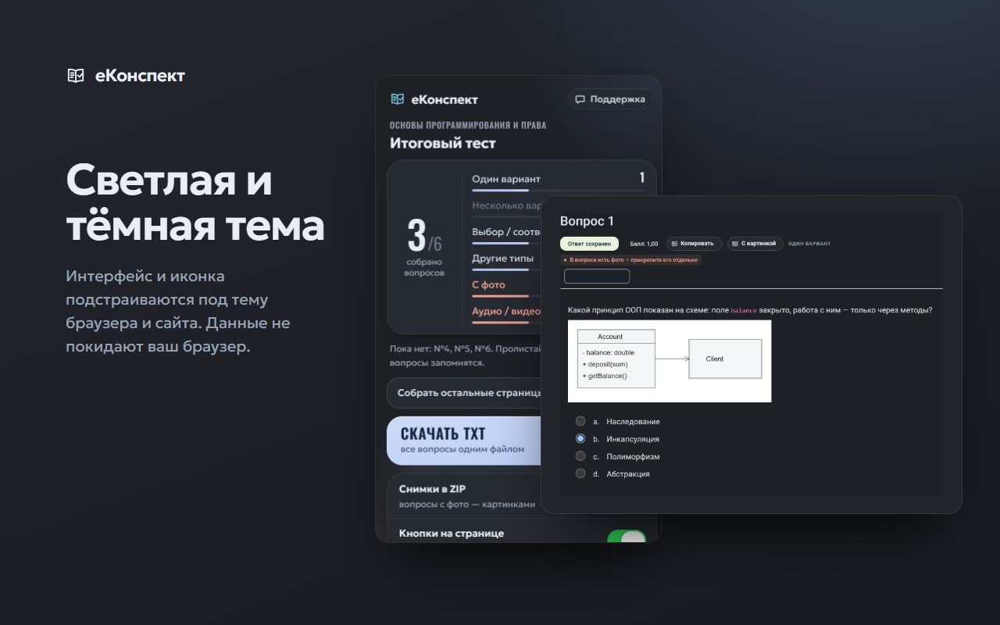
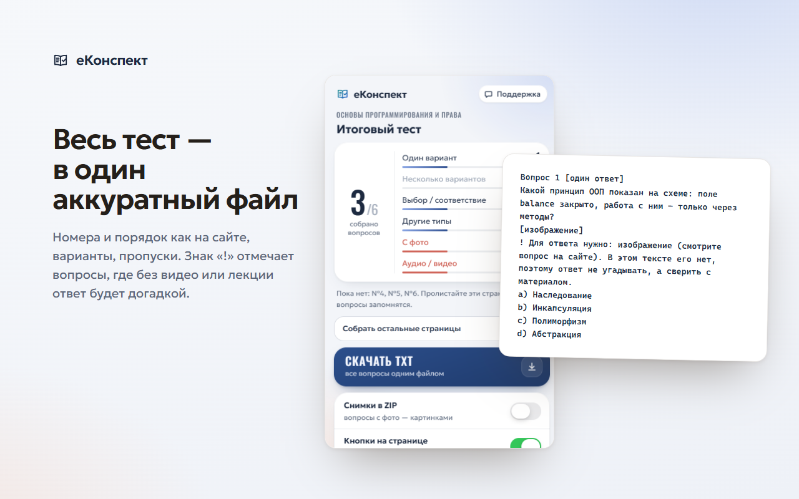
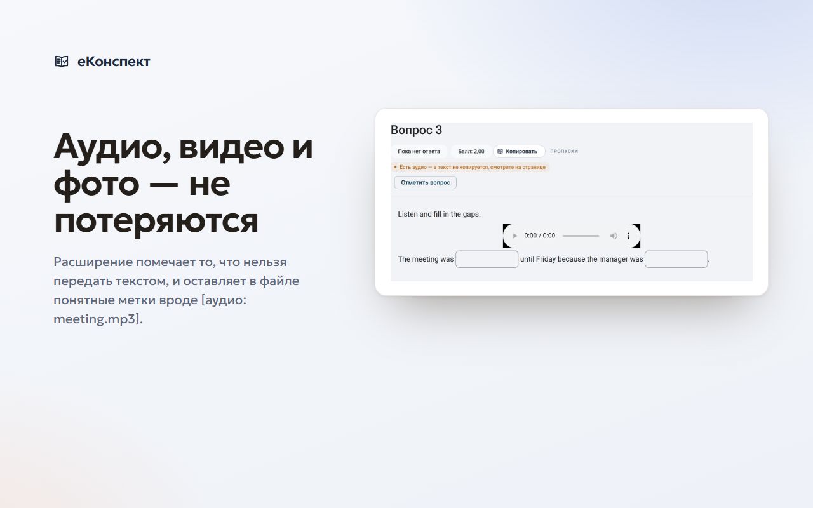

# еКонспект — вопросы теста в один файл

[](https://github.com/ktyfujkjdfx/ekonspekt/actions/workflows/ci.yml)

Браузерное расширение для студентов: вопросы тестов с сайта электронных курсов (Moodle) — в один аккуратный файл за клик. Для повторения, подготовки к экзаменам и работы с нейросетями.

> **Проект неофициальный.** Он не связан с владельцами и разработчиками сайта электронных курсов и с Moodle Pty Ltd и не одобрен ими. Расширение только читает страницы, которые открыл студент: оно не отвечает на вопросы и ничего не отправляет от его имени.



## Возможности
- **«Копировать»** у каждого вопроса теста: вопрос, варианты и тип — в буфер обмена. У вопросов с картинкой — **«С картинкой»**: одна картинка с текстом вопроса и рисунком, которую одинаково вставляют ChatGPT, Claude, Gemini, Qwen и Word.
- **Весь тест одним файлом** (TXT или ZIP со снимками вопросов с фото). В просмотре результатов — ваши ответы, «верно / неверно», баллы и правильные ответы, если преподаватель их показывает.
- **Формат для нейросетей**: короткий, без украшений; знак «!» отмечает вопросы, для ответа на которые нужен материал вне файла (видео, аудио, рисунок), — нейросеть не выдумывает ответ. Уже проверенные ответы прошлых попыток добавляются к тем же вопросам.
- **Поддержка** в окне расширения: готовое письмо разработчику в Gmail, Яндекс Почте, Mail.ru или почтовой программе.

| Тёмная тема | Выгрузка | Пометки «!» |
|---|---|---|
|  |  |  |

## Установка

**Из магазинов** (после публикации): Chrome Web Store · Microsoft Edge Add-ons · Firefox Add-ons — ссылки появятся здесь.

**Вручную (Chrome, Яндекс.Браузер, Edge, Opera)**
1. Скачайте `ekonspekt-chrome-<версия>.zip` со страницы [Releases](https://github.com/ktyfujkjdfx/ekonspekt/releases) и распакуйте в постоянную папку.
2. Откройте `chrome://extensions` (Edge — `edge://extensions`, Opera — `opera://extensions`, Яндекс — `browser://extensions`), включите «Режим разработчика», нажмите «Загрузить распакованное» и выберите папку.
3. Обновите открытую страницу теста (F5).

**Вручную (Firefox 140+)**: подписанный файл `ekonspekt-firefox-<версия>.xpi` из [Releases](https://github.com/ktyfujkjdfx/ekonspekt/releases) — откройте его в Firefox и подтвердите установку. Без подписи расширение можно поставить только временно: `about:debugging` → «Этот Firefox» → «Загрузить временное дополнение».

Подробно и с картинками — [INSTALL.md](INSTALL.md).

## Как пользоваться

| Где | Что делать |
|---|---|
| Любой вопрос | «Копировать» в шапке вопроса; у вопросов с картинкой — «С картинкой» |
| Просмотр результатов | Значок расширения → «Скачать TXT/ZIP». Все страницы попытки соберутся сами |
| Во время теста | Вопросы запоминаются, пока вы листаете тест; «Собрать остальные страницы» — при свободной навигации |

### Про «Собрать остальные страницы» в попытке
Расширение выполняет обычные GET-запросы `attempt.php?page=N`, то же самое, что клик по номеру вопроса. Ответы не отправляются, таймер не сбрасывается. Но у этого есть последствия:
- Moodle запишет просмотры страниц в журнал, и преподаватель может это увидеть;
- «текущей страницей» попытки станет последняя загруженная;
- если время теста вышло, Moodle может при запросе закрыть попытку (так он поступил бы и при обычном клике).

Поэтому по умолчанию функция выключена: при первом использовании нужно подтвердить предупреждение. Кнопка показывается только при свободной навигации.

### Какие вопросы поддерживаются

| Тип вопроса (имя в Moodle) | Метка в файле | Как выглядит | Ограничения |
|---|---|---|---|
| Один ответ (multichoice, truefalse, calculatedmulti) | `[один ответ]` | текст и варианты `a) …` | — |
| Несколько ответов (multichoice, multichoiceset, oumultiresponse) | `[несколько ответов]` | текст и варианты | — |
| Соответствие (match, randomsamatch) | `[соответствие]` | `Варианты: A / B / C` один раз, затем `- строка → ?` | — |
| Выбор пропущенных слов, перетаскивание в текст, вложенные ответы со списками (gapselect, ddwtos, multianswer) | `[выбор в пропусках]` | текст с `[1]`, `[2]` и строки `[1] A / B` | — |
| Вложенные ответы с полями ввода (multianswer) | `[пропуски]` | текст с `[N]`, без лишнего списка | — |
| Короткий и числовой ответ, вычисляемые (shortanswer, numerical, calculated) | `[свой ответ]` | текст и `Ответ: ___` (+ единицы) | допуск ответа сайт не показывает |
| Эссе (essay) | `[эссе]` | текст задания | вложения — только имена файлов |
| Упорядочивание (ordering) | `[порядок]` | `Расставить по порядку: …` | — |
| Перетаскивание на изображение, маркеры, линии (ddimageortext, ddmarker, drawlines) | `[задание на изображении]` | подписи элементов и `! Для ответа нужно: изображение` | **нужен снимок** (есть в архиве) |
| Информационный блок (description) | `Инфо` | текст (не считается вопросом) | — |
| Неизвестный тип | `[другой тип]` | весь видимый текст | — |

**Знак «!» — защита от выдуманных ответов.** Если для ответа нужен материал, которого в тексте нет (видео, аудиозапись, «см. учебник», «по тексту», изображение), под вопросом стоит строка `! Для ответа нужно: … В этом тексте его нет, поэтому ответ не угадывать, а сверить с материалом.` В шапке файла одно предложение объясняет знак «!». Фраза одинаково понятна человеку и нейросети: если файл отдать нейросети, она не будет сочинять ответы, а студент сразу видит, что нужно пересмотреть.

Аудио, видео, интерактивные и внешние задания текстом не передаются: в тексте ставится `[аудио: файл.mp3]`, у вопроса появляется пометка, а в шапке файла перечисляются такие вопросы. Картинки в тексте помечаются `[изображение]`, у вопроса появляется красная пометка, а в архив кладётся снимок всего вопроса.

При просмотре результатов (переключатель «Мои ответы и результат») добавляются ваши ответы, ✓ / ✗ по каждому полю, баллы, итог попытки и правильные ответы, **если преподаватель их показывает**. Подробности по разметке — в [reports/Разметка типов вопросов Moodle.md](reports/Разметка%20типов%20вопросов%20Moodle.md).

## Приватность и безопасность
- Всё хранится только в браузере (`storage.local`): накопленные вопросы попыток (удаляются через 30 дней), текст открытых учебных страниц курса, отметки «верно / неверно», настройки. Никакой аналитики, рекламы и серверов.
- Сеть — только к сайту электронных курсов, только чтение страниц (GET). Запросы к любым другим адресам заблокированы в коде.
- Разрешения минимальные: доступ к одному сайту, `storage`; в Firefox — ещё `downloads` для сохранения файлов.
- Подробно: [PRIVACY.md](PRIVACY.md) (её же публикуем через GitHub Pages: `docs/privacy.html`). Об уязвимостях — [SECURITY.md](SECURITY.md).

## Ограничения
- Работает только на сайте `https://e.sfu-kras.ru`.
- Видео, аудио и интерактивные задания текстом не передаются — вместо них пометка «!».
- Правильные ответы попадают в файл, только если их показывает сам сайт.
- Если сайт изменит разметку страниц, часть данных может не распознаться — напишите через «Поддержку».

## Разработка

Требования: Node.js 24 (`.nvmrc`), npm 11.

```bash
npm ci                     # точная установка по package-lock.json
npm run check              # типы + ESLint + Prettier + юнит-тесты + сборки + web-ext lint
npm run build:chrome       # → dist/chrome (Chrome, Edge, Яндекс, Opera)
npm run build:firefox      # → dist/firefox
npm run release            # check + архивы для магазинов + исходники для AMO + проверка архивов (release/)
npm run e2e                # браузерная проверка в Chromium на фикстурах (npx playwright install chromium)
npm run e2e:firefox        # то же в настоящем Firefox (нужен свободный порт 443)
npm run store-assets       # картинки для витрин магазинов (store/)
npm run dump -- test/fixtures/review-cloze-audio.html --results   # показать TXT по странице
npm run sanitize-fixture -- <страница.html> test/fixtures/<имя>.html   # обезличить страницу для тестов
node scripts/make-icons.mjs  # перегенерировать иконки из icons/src/book.svg
```

```
src/parser      разметка Moodle → структуры вопросов и страниц; без UI
src/format      формат TXT, проверенные ответы
src/content     кнопки на странице, сбор страниц, снимки, ZIP, сетевой сторож
src/popup       окно расширения
src/background  иконка под тему; в Firefox — сохранение файлов
src/shared      API браузера, настройки, сообщения, поддержка, санитайзер, флаги
manifests/      base.json + отличия chrome.json / firefox.json; src/_locales — ru/en
test/           юнит-тесты (vitest + jsdom), фикстуры — только обезличенные страницы
```

Флаги функций — `src/shared/features.ts` (например, кнопку «С картинкой» можно выключить одной строкой). Как добавить фикстуру по жалобе и что проверять перед релизом — [CONTRIBUTING.md](CONTRIBUTING.md) и [PUBLISHING.md](PUBLISHING.md).

## Лицензия
[MIT](LICENSE). Встроенные библиотеки: html-to-image и fflate (MIT), шрифты Geologica и Oswald (SIL OFL 1.1).

---

### In English
**eKonspekt** is an unofficial browser extension for students of a Moodle-based e-learning site (`e.sfu-kras.ru`). It copies quiz questions in one click, exports a whole quiz to one compact TXT/ZIP file for revision and AI assistants, and marks questions that need external material (video, audio, images) so that AI does not guess. It only reads pages the student opened, stores data locally, talks to no server except the e-learning site itself (read-only GET requests), and has no analytics. The UI is in Russian. Not affiliated with the owners of the e-learning site or with Moodle Pty Ltd.
